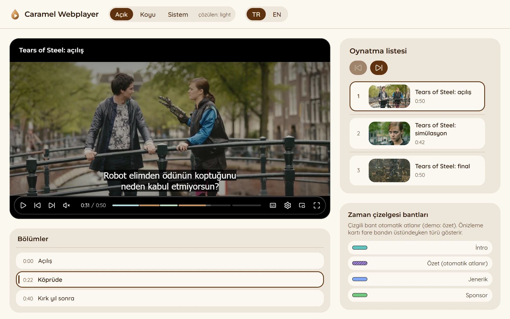

<p align="center">
  
</p>

<h1 align="center">Caramel Webplayer</h1>

<p align="center">
  <a href="https://www.npmjs.com/package/@esershnr/caramel-webplayer"></a>
  <a href="LICENSE"></a>
  <a href="https://github.com/esershnr/caramel-webplayer/actions/workflows/ci.yml"></a>
</p>

<p align="center">
  <a href="https://esershnr.github.io/caramel-webplayer/"><strong>Live demo</strong></a>
  ·
  <a href="#quick-start">Quick start</a>
  ·
  <a href="#theming--renkleri-değiştirme">Theming</a>
</p>

<a href="https://esershnr.github.io/caramel-webplayer/">
  <picture>
    <source media="(prefers-color-scheme: dark)" srcset=".github/assets/screenshot-dark.webp">
    
  </picture>
</a>

https://github.com/user-attachments/assets/9d378b7f-71d3-46bc-96da-5ce669c75c35

A themed Video.js 10 player, built for esersahiner.com: skin with morphing
Lucide icons, skip intro / recap / outro / sponsor, chapter list, playlist with
resume. Built on `@videojs/html` custom elements with thin React wrappers
(`'use client'`, elements registered in the browser only, so the Next.js App
Router stays SSR clean).

Contents: [Quick start](#quick-start), [Packages](#packages),
[Modular install](#modular-install), [Theming](#theming--renkleri-değiştirme),
[Development](#development), [Contributing](#contributing), [License](#license).

TR: Caramel Webplayer, esersahiner.com için yapılmış temalı bir Video.js 10
oynatıcısıdır: morf eden Lucide ikonlu skin, intro / özet / kapanış / sponsor
atlama, bölüm listesi ve kaldığı yerden devam eden oynatma listesi. Tek paket
(`@esershnr/caramel-webplayer`) her şeyi getirir; renkler `--caramel-*` CSS
değişkenleriyle değişir. Katkı rehberi ve belgeler İngilizcedir.

## Quick start

One package brings everything:

```sh
npm install @esershnr/caramel-webplayer @videojs/html
```

```ts
import '@esershnr/caramel-webplayer/webplayer.css'; // tokens + skin, up front
import '@esershnr/caramel-webplayer/define'; // registers every element
import { mountSkin } from '@esershnr/caramel-webplayer';

const player = document.querySelector('video-player')!;
const video = Object.assign(document.createElement('video'), { src: '/video.mp4', playsInline: true });
const skip = document.createElement('caramel-skip-segments');
skip.setAttribute('segments', JSON.stringify([{ start: 0, end: 30, type: 'intro' }]));
mountSkin(player, { media: video, extras: [skip] });
```

React (Next.js App Router included):

```tsx
'use client';
import '@esershnr/caramel-webplayer/webplayer.css';
import { CaramelVideoSkin, SkipSegments, ChaptersPanel } from '@esershnr/caramel-webplayer/react';

<CaramelVideoSkin id="player" lang="tr" extras={<SkipSegments segments={[{ start: 0, end: 30, type: 'intro' }]} />}>
  <video src="/video.mp4" playsInline />
</CaramelVideoSkin>
<ChaptersPanel playerId="player" />
```

`@esershnr/caramel-webplayer` re-exports all packages below (the two
`findActiveIndex` helpers as `findActiveSegmentIndex` and
`findActiveChapterIndex`). Install the packages one by one instead when you
only need some of them (see "Modular install").

## Packages

| Package | npm | Purpose |
| --- | --- | --- |
| `@esershnr/caramel-webplayer` | [](https://www.npmjs.com/package/@esershnr/caramel-webplayer) | Everything below in one install: re-exports, `/define` (all elements), `/react` (all wrappers), `/webplayer.css` (tokens + full skin CSS) |
| `@esershnr/caramel-theme` | [](https://www.npmjs.com/package/@esershnr/caramel-theme) | `--caramel-*` design tokens (latte / bitter palette, motion, radii, typography), `resolveTheme`, `watchTheme` |
| `@esershnr/caramel-icons` | [](https://www.npmjs.com/package/@esershnr/caramel-icons) | Lucide icon registry, `iconToSvg`, `<caramel-morph-icon>` (Morphicons spring morphing driven by `data-*` attributes) |
| `@esershnr/caramel-skin` | [](https://www.npmjs.com/package/@esershnr/caramel-skin) | Video.js 10 default video skin source (shadcn copy) themed with caramel tokens and Lucide icons; `mountSkin`, `<CaramelVideoSkin>` |
| `@esershnr/caramel-skip-segments` | [](https://www.npmjs.com/package/@esershnr/caramel-skip-segments) | `<caramel-skip-segments>`: skip intro / recap / outro / sponsor button, auto-skip per type, timeline markers; `<SkipSegments>` for React |
| `@esershnr/caramel-chapters` | [](https://www.npmjs.com/package/@esershnr/caramel-chapters) | `<caramel-chapters-panel>`: chapter list outside the video, fed by the player's chapters track; `<ChaptersPanel>` |
| `@esershnr/caramel-playlist` | [](https://www.npmjs.com/package/@esershnr/caramel-playlist) | `PlaylistModel`, `<caramel-playlist>` controller (title, poster, media, tracks and segments per item, resume via localStorage, auto advance) and `<caramel-playlist-panel>`; `<Playlist>`, `<PlaylistPanel>` |
| `@esershnr/caramel-gen-thumbs` | not published (`scripts/`) | `caramel-gen-thumbs`: ffmpeg sprite sheets plus a `#xywh=` WebVTT storyboard (`scripts/gen-thumbs/README.md`) |
| `@esershnr/caramel-encode-hls` | not published (`scripts/`) | `caramel-encode-hls`: `media/<slug>` (video, SRT, meta.yaml) to publish-ready `out/<slug>` (byte-range HLS, poster, thumbnails, chapters, subtitles, manifest). Guide: `scripts/encode-hls/README.md` |

## Modular install

Pick only the packages you need:

```sh
npm install @esershnr/caramel-skin @esershnr/caramel-skip-segments @videojs/html
```

### HTML

```ts
import '@esershnr/caramel-theme/tokens.css';
import '@esershnr/caramel-skin/define';
import '@esershnr/caramel-skip-segments/define';
import { mountSkin } from '@esershnr/caramel-skin';

const player = document.querySelector('video-player');
const video = Object.assign(document.createElement('video'), { src, playsInline: true });
const skip = document.createElement('caramel-skip-segments');
skip.setAttribute('segments', JSON.stringify([{ start: 0, end: 30, type: 'intro' }]));
skip.setAttribute('auto-skip', 'recap');
mountSkin(player, { media: video, extras: [skip] });
```

Wrap the player in `<media-i18n lang="tr">` (or set `lang` on an ancestor) for
Turkish labels. Chapters come from `<track kind="chapters" default>`, timeline
thumbnails from `<track kind="metadata" label="thumbnails" default>`.

With a playlist the media element starts empty and the controller fills in
everything per item (see `packages/playlist/src/types.ts` for the contract):

```ts
import '@esershnr/caramel-chapters/define';
import '@esershnr/caramel-playlist/define';
import '@videojs/html/media/hls-video'; // for .m3u8 items

const playlist = document.createElement('caramel-playlist');
playlist.id = 'playlist';
playlist.items = items; // PlaylistItem[]
mountSkin(player, { media: document.createElement('hls-video'), extras: [skip, playlist] });
```

```html
<caramel-chapters-panel for="player"></caramel-chapters-panel>
<caramel-playlist-panel for="playlist"></caramel-playlist-panel>
```

### React

```tsx
import { CaramelVideoSkin } from '@esershnr/caramel-skin/react';
import { SkipSegments } from '@esershnr/caramel-skip-segments/react';

<CaramelVideoSkin id="player" lang="tr" extras={<><SkipSegments segments={[]} autoSkip={['recap']} /><Playlist id="playlist" items={items} /></>}>
  <hls-video playsinline="" crossorigin="anonymous" />
</CaramelVideoSkin>
<ChaptersPanel playerId="player" />
<PlaylistPanel for="playlist" />
```

### Thumbnails

```sh
pnpm --filter @esershnr/caramel-gen-thumbs start -- video.mp4 --interval 2 --columns 6 --out public/thumbs --name bike --base-url /thumbs
```

Under Git Bash prefix the command with `MSYS_NO_PATHCONV=1` so `--base-url /thumbs`
is not rewritten to a Windows path.

Tiles default to 320px wide (`--width`). The timeline preview card takes the
tile width from the VTT `#xywh` fragment and shows it 1:1, so the card is as
wide as one tile; set `--caramel-preview-width` to force another width (larger
values upscale). Changing the tile width of a published video means
re-encoding and uploading to a new version folder (`v2/`), see
`scripts/encode-hls/README.md`.

## Theming / Renkleri değiştirme

Every color is a CSS custom property on `:root`, declared once with
`light-dark(light, dark)`. Override the main tokens and every hover, contrast
and overlay derivative follows (they are `color-mix()` expressions over the
main tokens, see `packages/theme/styles/tokens.css`).

TR: Renkler `--caramel-*` değişkenleridir; yalnız ana token'ları ezmeniz yeterlidir,
hover ve türevler kendiliğinden uyar. Override'lar `tokens.css`'ten SONRA
yüklenmelidir.

### Main tokens

| Token | Role | Light (latte) | Dark (bitter) |
| --- | --- | --- | --- |
| `--caramel-bg` | page background | `#fbf7f0` | `#141414` |
| `--caramel-surface` | panel (playlist, chapters, settings menu, preview card) | `#ece5da` | `#2d2d2d` |
| `--caramel-raised` | box inside a panel, list row | `#faf7f2` | `#242424` |
| `--caramel-divider` | separators (decorative) | `#d2c4b0` | `#454545` |
| `--caramel-border` | interactive edge (3:1 or better) | `#8a5f36` | `#8a8a8a` |
| `--caramel-text` | body text | `#2a1606` | `#ffffff` |
| `--caramel-muted` | secondary text | `#553821` | `#b8b0a6` |
| `--caramel-primary` | indicator: selection, focus ring, active marker | `#5e3310` | `#c9945c` |
| `--caramel-solid` | filled button, active item | `#5e3310` | `#8a5a2b` |
| `--caramel-accent` | decoration only: progress fill, lines, badges. Never text. | `#c9945c` | `#c9945c` |
| `--caramel-accent-text` | readable accent for text and icons | `#653d19` | `#d9ae7e` |
| `--caramel-segment-intro` | timeline band: intro (teal) | `#5ec4c0` | same |
| `--caramel-segment-recap` | timeline band: recap (violet) | `#b294ee` | same |
| `--caramel-segment-outro` | timeline band: outro (blue) | `#7fa7f5` | same |
| `--caramel-segment-sponsor` | timeline band: sponsor (green) | `#72c67e` | same |

Derived (override only if you need to): `--caramel-raised-hover`, `--caramel-primary-hover`,
`--caramel-primary-contrast`, `--caramel-solid-hover`, `--caramel-solid-contrast`,
`--caramel-overlay-accent`, `--caramel-overlay-on-accent`, `--caramel-quality-badge-bg`,
`--caramel-quality-badge-text`, `--caramel-segment-ring`, `--caramel-segment-hatch`. Non-color tokens: radii
(`--caramel-radius-panel/box/chip`), motion (`--caramel-ease-*`, `--caramel-duration-*`),
fonts (`--caramel-font-heading/body`), focus ring (`--caramel-focus-ring/offset`),
timeline preview card width (`--caramel-preview-width`, unset by default: the
sprite tile width, or 240px without thumbnails).

### Example 1: change one color

```css
/* after tokens.css */
:root {
  --caramel-accent: #2f80ed;
}
```

The progress fill, the quality badge and the overlay accent all follow. The
segment bands have their own tokens (below).

### Example 2: separate light and dark values

```css
:root {
  --caramel-primary: light-dark(#1d4ed8, #93c5fd);
  --caramel-solid: light-dark(#1d4ed8, #1e40af);
}
```

### Example 3: a preset

```ts
import '@esershnr/caramel-theme/tokens.css';
import '@esershnr/caramel-theme/presets/catppuccin-mocha.css'; // or presets/neutral.css
```

Presets override the main tokens only and document their contrast ratios in
the file header.

### Load order and scoped themes

Overrides must come after `tokens.css` (same specificity, later wins). To theme
one player differently on the same page, scope the override to a wrapper; the
tokens inherit, so the wrapper's values win inside it:

```css
.player-mocha {
  --caramel-bg: light-dark(#eff1f5, #1e1e2e);
  --caramel-surface: light-dark(#e6e9ef, #313244);
  --caramel-accent: #fab387;
  /* ... */
}
```

```html
<div class="caramel-theme">… default player …</div>
<div class="caramel-theme player-mocha">… Catppuccin player …</div>
```

### Scheme selection

Put `.caramel-theme` on the elements that should follow the scheme (panels, page
body, or a wrapper). Precedence: a local `data-theme="light|dark"` on that
element or an ancestor, then `data-theme` / `.dark` / `.light` on `<html>`,
then `prefers-color-scheme`. `watchTheme()` from `@esershnr/caramel-theme`
reports changes to JavaScript.

### Timeline segment bands

`<caramel-skip-segments>` paints intro / recap / outro / sponsor ranges onto the
timeline. Each type has its own color, in the SponsorBlock language with a
softer saturation: intro teal, recap violet, outro blue, sponsor green. They
sit on the video, so one value serves both schemes.

- Every band has a 1px dark ring (`--caramel-segment-ring`). A band color cannot
  contrast 3:1 with both the dark unplayed track and the caramel played fill
  (one needs a light color, the other a dark one), so the band contrasts with
  the track (5:1 or more) and the ring with the fill (6.1:1). The table is in
  `packages/theme/styles/tokens.css`.
- The played part of a band is a lighter tint of the same color, so progress
  stays visible inside it.
- Types that are auto-skipped (`auto-skip="recap"`) get static diagonal stripes
  (`--caramel-segment-hatch`); types you skip with the button stay flat.
- Hovering a band adds a small type chip ("İntro", "Sponsor"; "Intro",
  "Sponsor" in English) in the band color to the preview card.

TR: Bant renkleri `--caramel-segment-intro/recap/outro/sponsor` ile değişir. Çizgili
bant otomatik atlanan türdür, düz bant elle atlanan.

### Controls over the video stay dark

Everything drawn on top of the frame (control bar, skip button, tooltips) uses
the `--caramel-overlay-*` roles and does not follow the page theme: video frames
can be bright or dark at any moment, and a dark frosted bar keeps white text
and the caramel accent readable on both. Only the panels outside the frame and
the settings menu / preview card switch with the page.

### Contrast responsibility

When you change colors, keep these pairs (WCAG):

| Pair | Minimum |
| --- | --- |
| `--caramel-text` on bg / surface / raised | 4.5:1 (aim 7:1) |
| `--caramel-muted` on bg / surface / raised | 4.5:1 |
| `--caramel-accent-text` on surface / raised | 4.5:1 |
| `--caramel-solid-contrast` on `--caramel-solid` | 4.5:1 |
| `--caramel-primary` on surface / raised (indicator, ring) | 3:1 |
| `--caramel-border` on surface / raised | 3:1 |
| `--caramel-quality-badge-text` on `--caramel-quality-badge-bg` | 4.5:1 |
| `--caramel-segment-*` on the unplayed track (about `#333333`) | 3:1 |
| `--caramel-segment-ring` on `--caramel-accent` (played fill) | 3:1 |

`--caramel-accent` is decorative and has no contrast requirement, which is why it
must not be used for text.

## Development

```sh
pnpm install
pnpm lint            # Biome lint (pnpm format:check / pnpm format for formatting)
pnpm test            # Vitest, pure logic plus a few happy-dom tests
pnpm typecheck
pnpm build           # dist/ for every package (needed before `vite build` in examples)
node tools/tos-demo.mjs  # demo clips (Tears of Steel), once; needs ffmpeg
pnpm dev:vanilla     # http://localhost:5173  (?theme=light|dark, ?dev adds the test streams)
pnpm dev:react       # http://localhost:5174
```

Open-state screenshots (settings menu, every submenu, volume popover, timeline
preview, playlist next item, chapter select; both demos, both themes) with the
installed Edge:

```sh
node tools/shots.mjs shots   # dev servers must be running
```

The skin template (`packages/skin/src/template.ts`) is generated from
`skin.html` by `pnpm --filter @esershnr/caramel-skin build:template`; run it
after editing `skin.html`.

## Contributing

Bug reports, fixes and ideas are welcome. Start with
[CONTRIBUTING.md](CONTRIBUTING.md) (setup, checks, commit format, changesets)
and [docs/package-playbook.md](docs/package-playbook.md) (how packages are
built). Please follow the [Code of Conduct](CODE_OF_CONDUCT.md) and report
security problems privately as described in [SECURITY.md](SECURITY.md).

## Demo media

The live demo and the screenshots use clips from
[Tears of Steel](https://mango.blender.org), (CC) Blender Foundation,
licensed [CC BY 3.0](https://creativecommons.org/licenses/by/3.0/). The clips
are not committed; `node tools/tos-demo.mjs` downloads the source into
`media/tos/` and writes them to `examples/vanilla/public/tos/` (the Pages
workflow does the same). The Turkish subtitles are a translation made for the
demo.

## License

MIT, Copyright (c) 2026 Eser Şahiner (see `LICENSE`). `@esershnr/caramel-skin`
is `MIT AND Apache-2.0`: it contains files derived from the Video.js 10 default
video skin (Apache License 2.0, `packages/skin/LICENSE-APACHE`). Lucide icon data
(ISC, partly MIT via Feather) and Morphicons (MIT) are credited in `NOTICE`.
